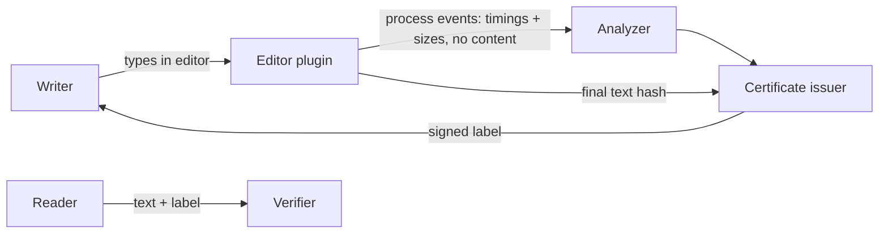

# Architecture — human-made

## 1. Scope
Process-based proof that a person wrote a piece of content, issued as a verifiable label.
**MVP:** process-log analysis (paste ratio, revision ratio, cadence CV, pause share, throughput),
verdict tiers (human-made, human-led, unverified) with reasons, HMAC certificates bound to
SHA-256 of the final text, verification, synthetic session generator for demos and tests.
**Product:** editor plugins, Ed25519 + C2PA manifests, privacy-preserving replay for disputes.

## 2. System context

## 3. Signals & thresholds
| Signal | Human pattern | Fails when |
|---|---|---|
| paste ratio | low | > 50% means unverified, > 10% means human-led |
| cadence CV (inter-key gaps ≤ 2 s) | irregular, CV ≳ 0.4 | < 0.25 with ≥ 50 typed chars (scripted) |
| throughput | 150–600 chars/active minute | > 900 |
| revision ratio | some deletes | < 2% over 500 chars means human-led note |

## 4. Design decisions
- **Measure the process, not the artefact.** Text-only AI detectors are unreliable and unfair to
  non-native writers. Process evidence is much harder to fake cheaply.
- **The process log records timings and sizes, not content.** It's privacy-preserving by construction.
- **Tiers instead of a binary.** "Human-led" honestly covers assisted writing and quotes, so the
  label is credible because it's not absolute.
- **The certificate binds to exact content** (one changed character fails verification) and to its
  signals, so a forged tier fails the signature check.

## 5. Production architecture
Plugins for VS Code, Google Docs and Obsidian. An issuer service (Ed25519 via KMS, JWKS). A public
verifier page and API. Optional dispute replay renders keystroke timing without characters.

## 6. Risks
Adversaries simulating human typing (bots with jitter). Layer in device attestation and long-range
behavioural consistency. Accessibility: dictation and assistive tech need an explicit, honest tier.
